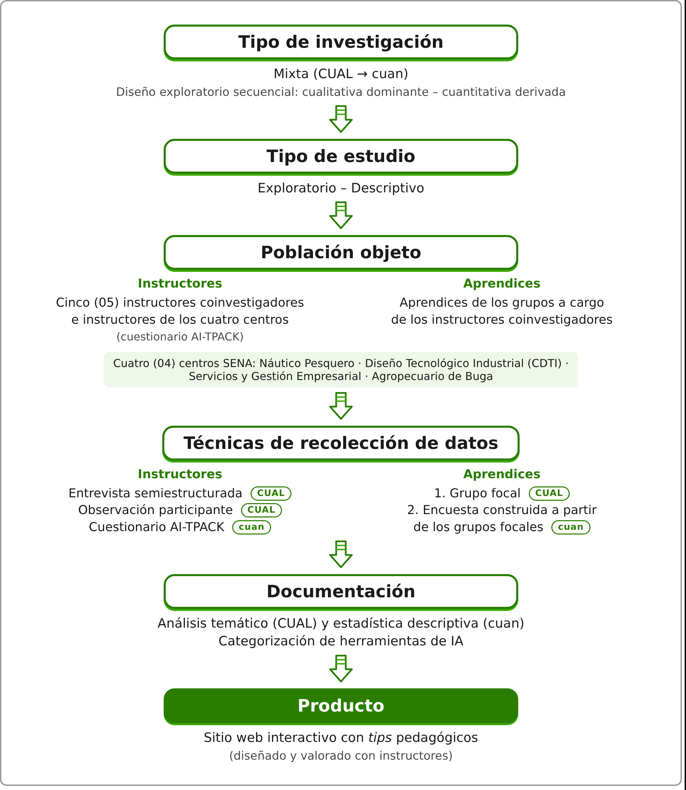

# 1. Título del proyecto

Brecha digital de conocimiento en el uso de la inteligencia artificial: diagnóstico y diseño participativo de una herramienta interactiva para procesos formativos inclusivos en el SENA

# 2. Resumen del proyecto

La inteligencia artificial (IA) generativa se ha incorporado con rapidez a los procesos formativos, pero de manera desigual. En los ambientes de formación del SENA se observa que algunos aprendices usan estas herramientas de forma superficial, que parte de los instructores no las domina y que, dentro de un mismo grupo, conviven niveles muy distintos de apropiación. Esta situación corresponde a la brecha digital de segundo nivel, centrada en las diferencias de habilidades y usos más que en el acceso (Hargittai, 2002; van Deursen & van Dijk, 2014), y puede derivar en exclusión formativa.

El referente conceptual articula cinco categorías: brecha digital de conocimiento, IA generativa en educación, Diseño Universal para el Aprendizaje, formación profesional y mediación pedagógica del instructor. El objetivo general es diseñar de manera participativa una herramienta interactiva mediada por IA que oriente pedagógicamente a los instructores del SENA, a partir del diagnóstico de las barreras asociadas a dicha brecha.

Metodológicamente, el estudio adopta un enfoque mixto con predominio cualitativo, un alcance exploratorio-descriptivo y un diseño de investigación-acción participativa (Kemmis et al., 2014) cuyo diagnóstico sigue un diseño exploratorio secuencial (CUAL → cuan), desarrollado durante doce meses en cuatro centros de formación de distintas regionales. Los datos cualitativos se recolectarán mediante entrevistas semiestructuradas y observación participante con instructores, y grupos focales con aprendices; los cuantitativos, mediante el cuestionario AI-TPACK aplicado a instructores de los cuatro centros y una encuesta a aprendices construida a partir de los hallazgos de los grupos focales. Se analizarán con análisis temático (Braun & Clarke, 2006) y estadística descriptiva, y se triangularán por técnica, fuente e investigador.

Como resultados se esperan una caracterización de las barreras asociadas a la brecha digital de conocimiento en el uso de la IA, una categorización de las herramientas de IA en uso, una matriz de requerimientos pedagógicos y funcionales, el prototipo de un sitio web interactivo con orientaciones pedagógicas (*tips*) para instructores y su valoración por parte de la comunidad formativa. El proyecto aporta conocimiento situado sobre un fenómeno poco explorado en la formación profesional colombiana y responde a la Política Nacional de Inteligencia Artificial (Departamento Nacional de Planeación [DNP], 2025).

# 3. Descripción del proyecto

## 3.1 Planteamiento del problema de investigación

### Contexto teórico general

La literatura sobre brecha digital ha evolucionado desde una concepción binaria, centrada en tener o no acceso a la tecnología, hacia una comprensión de las desigualdades en habilidades y usos. Hargittai (2002) acuñó la noción de brecha digital de segundo nivel al demostrar que, entre personas con acceso, existen diferencias considerables en la capacidad de usar la tecnología. Posteriormente, van Deursen y van Dijk (2014) mostraron que, a medida que la tecnología se masifica, sus usos tienden a reproducir las desigualdades sociales, económicas y culturales preexistentes. La irrupción de la IA generativa reactualiza este debate: la guía de la UNESCO advierte, entre sus controversias, el riesgo de agravar la pobreza digital y propone un enfoque humanista que promueva la agencia humana, la inclusión y la equidad (Miao & Holmes, 2023).

### Estado actual del conocimiento

En el ámbito mundial, los estudios sobre IA en la educación y formación técnica y profesional coinciden en que los docentes desarrollan sus competencias en IA de manera predominantemente autónoma y demandan acompañamiento formal (Berntsen et al., 2026; Jemetz & Motschnig, 2024). Una revisión sistemática reciente advierte, además, que la evidencia sobre la efectividad de la IA en este sector es metodológicamente limitada y que los enfoques que fortalecen la agencia del aprendiz y apoyan al docente siguen siendo minoritarios (Deutscher et al., 2026). De manera especialmente relevante para este estudio, Gunathilake y Liyanage (2026) encontraron que la IA generativa no nivela, sino que amplifica las competencias previas de los aprendices, lo que respalda empíricamente el riesgo de una brecha de segundo nivel. En América Latina, la investigación reporta que la integración de la IA enfrenta barreras de infraestructura y de formación docente (Juro Llamocca et al., 2025) y que la formación específica en IA mejora la apropiación pedagógica de estas herramientas (Rodríguez Vela et al., 2026). En Colombia, el trabajo identificado en el SENA se ha concentrado en la integración de asistentes de IA en plataformas institucionales desde la perspectiva del aprendiz (Osorio Ortega, 2025). El detalle de estos estudios se presenta en el apartado 3.4.

### Naturaleza y magnitud del problema

A partir de la experiencia docente y del ejercicio grupal desarrollado en un espacio de formación de instructores, se observa que la IA se integra de manera desigual en los procesos formativos del SENA. En primer lugar, una parte de los aprendices hace un uso superficial de estas herramientas: reproduce sus respuestas sin analizarlas ni verificarlas. En segundo lugar, algunos instructores no dominan la IA o evitan incorporarla en su práctica pedagógica. Como resultado, dentro de un mismo grupo conviven aprendices que aprovechan la IA con otros que no la usan o la usan sin criterio. Si no se atiende, esta brecha puede convertirse en exclusión formativa, en contravía del carácter inclusivo de la formación profesional.

La magnitud del fenómeno en el SENA no ha sido cuantificada; precisamente, la fase de diagnóstico permitirá dimensionarla en los cuatro centros participantes: Centro Náutico Pesquero, Centro de Diseño Tecnológico Industrial, Centro de Servicios y Gestión Empresarial y Centro Agropecuario de Buga *(regionales por precisar)*. La diversidad de áreas productivas de estos centros permitirá comprender cómo se manifiesta la brecha en contextos distintos.

### Brechas existentes y vacío que se quiere llenar

En la búsqueda realizada no se identificaron estudios que aborden la brecha digital de conocimiento en el uso de la IA desde la perspectiva conjunta de instructores y aprendices del SENA, ni propuestas que traduzcan ese diagnóstico en orientaciones pedagógicas construidas de manera participativa con los propios instructores. Los antecedentes nacionales se centran en la integración tecnológica de la IA, mientras que los internacionales muestran que la formación docente en IA depende en gran medida de la iniciativa individual. Además, la búsqueda sistemática en Scopus descrita en el apartado 3.4 recuperó 226 documentos sobre IA en educación y formación técnica y profesional, ninguno de ellos referido a Colombia ni a otro país de América Latina.

### ¿Por qué y cómo?

La investigación es necesaria porque la integración de la IA sin orientación pedagógica tiende a ampliar las desigualdades existentes. Se desarrollará mediante investigación-acción participativa, de modo que los instructores no solo sean fuente de información, sino coautores de la solución. Esta condición aumenta la probabilidad de que la herramienta resultante sea pertinente y adoptada en la práctica formativa.

## 3.2 Formulación del problema

**Pregunta general**

¿Qué características debe tener una herramienta interactiva mediada por IA para orientar pedagógicamente a los instructores del SENA en la reducción de la brecha digital de conocimiento en el uso de la IA, en procesos formativos inclusivos?

**Subpreguntas**

1. ¿Qué barreras asociadas a la brecha digital de conocimiento en el uso de la IA identifican instructores y aprendices de cuatro centros del SENA?
2. ¿Qué requerimientos pedagógicos y funcionales debe cumplir la herramienta para orientar a los instructores?
3. ¿Cómo valoran los instructores la pertinencia pedagógica y la usabilidad del prototipo construido?

| Pregunta | Objetivo | Ciclo de investigación-acción |
|---|---|---|
| General | Objetivo general: diseñar la herramienta | Diagnóstico y diseño |
| Subpregunta 1 | Específico 1: caracterizar las barreras | Diagnóstico (CUAL → cuan) |
| Subpregunta 2 | Específicos 2 y 3: requerimientos y prototipo | Diseño |
| Subpregunta 3 | Específico 4: valorar el prototipo | Diseño |

## 3.3 Justificación

**Pertinencia nacional.** Colombia adoptó en 2025 la Política Nacional de Inteligencia Artificial, cuyo objetivo es generar capacidades para la investigación, el desarrollo, la adopción y el aprovechamiento ético y sostenible de la IA con el fin de impulsar la transformación social y económica del país, con un horizonte de implementación hasta 2030 (DNP, 2025). Una formación profesional que no atienda la brecha de conocimiento en IA limitaría la contribución del SENA a ese propósito.

**Pertinencia mundial.** La UNESCO recomienda fortalecer la capacidad de los docentes para hacer un uso adecuado de la IA generativa y validar la pertinencia ética y pedagógica de estas herramientas antes de incorporarlas (Miao & Holmes, 2023). El proyecto se inscribe en esta orientación.

**Relevancia social e implicaciones prácticas.** Siguiendo los criterios de Hernández Sampieri et al. (2014), el estudio tiene relevancia social porque busca que los aprendices se beneficien por igual de la IA sin importar su nivel de habilidad digital, e implicaciones prácticas porque entrega un producto utilizable por los instructores.

**Aporte al conocimiento.** En el ámbito internacional, aporta evidencia desde la formación profesional latinoamericana a la discusión sobre la brecha digital de segundo nivel en la era de la IA generativa. En el ámbito nacional, caracteriza un fenómeno poco explorado en el SENA. En el ámbito local, produce conocimiento situado en cuatro contextos productivos distintos (náutico-pesquero, industrial, de servicios y agropecuario).

## 3.4 Antecedentes

### Internacionales

Berntsen et al. (2026) estudiaron, mediante un estudio de casos cualitativo y exploratorio en dos escuelas noruegas del programa de tecnologías de la información y producción de medios, cómo los docentes de formación profesional integran la IA en su enseñanza. Encontraron que los docentes transitan de transmisores de conocimiento a facilitadores, que su cualificación depende de la iniciativa personal y de redes informales, y que persisten tensiones en torno a la evaluación, la ética y el acceso desigual a las herramientas de IA.

Jemetz y Motschnig (2024) entrevistaron a diecinueve docentes de escuelas secundarias profesionales y generales de Austria, en contextos urbanos y rurales, para identificar cómo desarrollan sus competencias frente a la IA generativa. Hallaron que el aprendizaje autorregulado predomina y que los docentes demandan formación actualizada, con ejemplos prácticos y orientada por expertos; varios de ellos enfrentan aprendices con niveles muy distintos de competencia digital y en IA.

Sáez León (2024) analizó en España la capacidad de la IA generativa como recurso para el profesorado de Formación Profesional, incluida la implementación del Diseño Universal para el Aprendizaje, y concluyó que la herramienta resulta útil, pero no fiable sin supervisión experta, por lo que la formación docente en IA es clave para su uso adecuado.

### Latinoamericanos

Juro Llamocca et al. (2025) examinaron la relación entre la adopción de herramientas de IA y la brecha tecnológica en docentes de institutos pedagógicos y tecnológicos de Apurímac (Perú). Reportaron disposición favorable hacia la IA, pero también barreras de infraestructura y de formación en TIC, y recomendaron formación docente sostenida y políticas inclusivas. Cabe advertir que el artículo presenta inconsistencias en el tamaño de muestra reportado, por lo que sus cifras deben leerse con cautela.

Rodríguez Vela et al. (2026) desarrollaron en México un estudio cuasiexperimental con estudiantes de formación inicial docente y encontraron que una intervención sobre el uso de la IA en el diseño de proyectos mejoró el conocimiento y el uso académico de estas herramientas en el grupo experimental, sin cambios significativos en el grupo control. Los autores señalan como barreras regionales la escasa formación docente y la ausencia de contenidos estructurados sobre IA en los currículos.

### Nacionales

Osorio Ortega (2025) diseñó una propuesta piloto para integrar un asistente conversacional de IA en la plataforma ZAJUNA del SENA, con un enfoque mixto basado en una encuesta a 61 aprendices. Concluyó que la propuesta es viable y pertinente, dado que los aprendices ya utilizan herramientas de IA generativa y apoyarían su integración institucional bajo principios éticos.

### Síntesis

Los antecedentes muestran tres tendencias: la formación docente en IA es mayoritariamente autodidacta, la brecha en América Latina combina factores de acceso y de formación, y los estudios en el SENA se han orientado a la integración tecnológica desde la perspectiva del aprendiz. Ningún estudio identificado, ni en la búsqueda dirigida ni en la búsqueda sistemática en Scopus, combina el diagnóstico de la brecha de conocimiento con el diseño participativo de orientaciones pedagógicas para instructores, que es el vacío que este proyecto busca llenar.

### Búsqueda sistemática en Scopus

El 10 de noviembre de 2026 se realizó una búsqueda en Scopus combinando términos de inteligencia artificial («artificial intelligence», «generative AI», ChatGPT) con términos de educación y formación técnica y profesional («vocational education», «vocational training», TVET). El registro exportado contiene 226 documentos. Su cribado por título y resumen arrojó tres hallazgos: el predominio de estudios de China, Indonesia y Europa; la concentración en la adopción tecnológica y en escalas de competencia docente; y la ausencia de estudios de Colombia o de América Latina (cero registros con esos descriptores en título, resumen o palabras clave). Los estudios seleccionados se incorporan a continuación.

### Internacionales (resultados de la búsqueda en Scopus)

Gunathilake y Liyanage (2026) estudiaron, con un diseño mixto, a 323 estudiantes de una universidad de tecnología vocacional de Sri Lanka y concluyeron que la IA generativa no actúa como nivelador, sino como amplificador de competencias: favorece a quienes ya tienen mayor dominio y conciencia de la herramienta y puede privar a los demás de adquirir habilidades básicas. Recomiendan una secuencia pedagógica que garantice primero los fundamentos y luego introduzca la IA.

Metreveli et al. (2025) analizaron un currículo de IA en la formación profesional sueca y entrevistaron a catorce estudiantes, quienes demandaron más acompañamiento personalizado de instructores dedicados, mejor estructura curricular y más habilidades prácticas. El estudio plantea explícitamente la pregunta de quiénes quedan rezagados en este proceso.

Chan (2025) reunió, en un volumen editado, una serie de estudios de investigación-acción participativa en la formación profesional de Aotearoa Nueva Zelanda, en los que diseñadores de aprendizaje y docentes planificaron conjuntamente actividades con IA generativa; el libro sintetiza un marco y unas pautas para integrar la IA en el currículo vocacional. Constituye el antecedente metodológico más cercano a esta propuesta.

Deutscher et al. (2026) revisaron sistemáticamente 26 estudios empíricos sobre intervenciones con IA en la formación profesional y hallaron efectos positivos de la realidad extendida inteligente, los tutores inteligentes y los chatbots, pero con una base metodológica limitada y un predominio de diseños centrados en la ejercitación.

Setiyawan et al. (2025) adaptaron y validaron con 460 docentes vocacionales de Indonesia la escala AI-TPACK, que mide el conocimiento tecnológico, pedagógico y de contenido para integrar la IA. Este instrumento sirve de referencia para el cuestionario complementario de esta propuesta.

Cabellos et al. (2026) aplicaron un cuestionario a 566 estudiantes de Formación Profesional en España y encontraron actitudes en general favorables hacia la IA generativa, más marcadas en quienes tienen creencias pedagógicas constructivistas y mayor uso previo de estas herramientas.

# 4. Referente conceptual

El referente se organiza alrededor de una categoría central y cinco categorías relacionadas, siguiendo la representación gráfica de planteamientos cualitativos propuesta por Hernández Sampieri et al. (2014).

| Categoría | Definición de trabajo y relación con el estudio |
|---|---|
| **Brecha digital de conocimiento en IA** (central) | Diferencias entre personas con acceso a la tecnología en sus habilidades y formas de uso (Hargittai, 2002), que tienden a reproducir desigualdades sociales preexistentes (van Deursen & van Dijk, 2014). En este estudio se refiere a las diferencias en el uso de la IA entre instructores y aprendices. |
| IA generativa en educación | Sistemas capaces de generar contenido, cuya integración educativa debe orientarse por un enfoque humanista, ético y centrado en la agencia humana (Miao & Holmes, 2023). |
| Inclusión y Diseño Universal para el Aprendizaje | Marco que orienta el diseño de experiencias accesibles mediante múltiples formas de compromiso, representación, y acción y expresión (CAST, 2024). Proporciona los criterios de inclusión de la herramienta. |
| Formación profesional | Contexto institucional del SENA, caracterizado por la formación para el trabajo en distintos niveles y áreas productivas. |
| Mediación pedagógica del instructor | Papel del instructor como facilitador del aprendizaje con IA; los antecedentes muestran el tránsito del docente hacia ese rol (Berntsen et al., 2026). |
| Herramienta interactiva + *tips* | Producto del diseño participativo: sitio web interactivo con orientaciones pedagógicas mediadas por IA para instructores. |

**Relaciones entre categorías.** La brecha digital de conocimiento se manifiesta en el contexto de la formación profesional y se ve condicionada por la mediación pedagógica del instructor. La IA generativa es a la vez el objeto de la brecha y el medio de la herramienta, mientras que el Diseño Universal para el Aprendizaje aporta los criterios para que la herramienta reduzca, en lugar de ampliar, la brecha.

# 5. Objetivos

## Objetivo general

Diseñar de manera participativa una herramienta interactiva mediada por IA que oriente pedagógicamente a los instructores del SENA en el desarrollo de procesos formativos inclusivos, a partir del diagnóstico de las barreras asociadas a la brecha digital de conocimiento en el uso de la IA.

## Objetivos específicos

1. Caracterizar las barreras asociadas a la brecha digital de conocimiento en el uso de la IA que identifican instructores y aprendices de cuatro centros de formación del SENA.
2. Establecer los requerimientos pedagógicos y funcionales que debe cumplir una herramienta interactiva mediada por IA para orientar a los instructores.
3. Construir con los instructores participantes el prototipo de un sitio web interactivo con orientaciones pedagógicas (*tips*) para el uso inclusivo de la IA.
4. Valorar con instructores participantes la pertinencia pedagógica y la usabilidad del prototipo.

**Conocimiento esperado.** Una caracterización situada de la brecha digital de conocimiento en el uso de la IA en la formación profesional colombiana. **Solución tecnológica esperada.** Un prototipo validado de sitio web interactivo con orientaciones pedagógicas para instructores.

# 6. Metodología propuesta

## 6.1 Ruta metodológica

*Figura 1.* Ruta metodológica de la propuesta. Elaboración propia a partir del modelo de ruta del Centro de Cartago (CTA).

## 6.2 Tipo de investigación, alcance y diseño

**Tipo de investigación.** El estudio adopta un enfoque mixto con predominio cualitativo. Su eje es la investigación-acción participativa, diseño que Hernández Sampieri et al. (2014) ubican entre los cualitativos y cuya finalidad es comprender y resolver problemáticas de una colectividad para transformar su realidad. Dentro del ciclo de diagnóstico se emplea un diseño exploratorio secuencial (DEXPLOS), con notación CUAL → cuan: primero se recolectan y analizan los datos cualitativos y, con base en sus hallazgos, se construye y aplica el instrumento cuantitativo dirigido a los aprendices. Este diseño es pertinente cuando el fenómeno ha sido poco estudiado y sus categorías aún no están definidas (Hernández Sampieri et al., 2014). El cuestionario AI-TPACK, por tratarse de un instrumento ya validado (Setiyawan et al., 2025), se aplica a los instructores en paralelo con la fase cualitativa.

**Alcance.** El alcance es exploratorio-descriptivo: exploratorio, porque el fenómeno ha sido poco estudiado en la formación profesional colombiana; descriptivo, porque el diagnóstico caracteriza las barreras, las competencias y las herramientas de IA en uso (Hernández Sampieri et al., 2014).

**Diseño.** El diseño es la investigación-acción participativa, entendida como un proceso en el que los participantes investigan su propia práctica para transformarla (Kemmis et al., 2014). El proyecto se desarrolla en dos ciclos: un ciclo de diagnóstico (objetivo 1) y un ciclo de diseño (objetivos 2, 3 y 4), cada uno con momentos de planificación, acción, observación y reflexión.

## 6.3 Contexto y participantes

**Contexto.** Cuatro centros de formación del SENA de distintas regionales: Centro Náutico Pesquero, Centro de Diseño Tecnológico Industrial, Centro de Servicios y Gestión Empresarial y Centro Agropecuario de Buga, en programas de distintos niveles de formación.

**Participantes.** La población tiene dos grupos:

- **Instructores.** Los cinco instructores del equipo investigador participan como coinvestigadores y usuarios de la herramienta, y son informantes de las entrevistas y la observación. Además, el cuestionario AI-TPACK se aplicará a los instructores de los cuatro centros que acepten participar, con un muestreo no probabilístico por conveniencia.
- **Aprendices.** Los aprendices de los grupos (fichas) a cargo de los instructores coinvestigadores participan como informantes del diagnóstico, en los grupos focales y la encuesta.

**Criterios de inclusión.** Instructores con al menos un grupo activo durante el periodo de recolección; aprendices matriculados en dichos grupos que acepten participar mediante consentimiento informado, o asentimiento con autorización del acudiente en el caso de menores de edad.

## 6.4 Procedimiento por objetivo

| Objetivo | Técnicas e instrumentos | Procedimiento | Análisis |
|---|---|---|---|
| 1 · Caracterizar barreras | Fase CUAL: entrevista semiestructurada y observación participante con diario de campo (instructores); grupo focal (aprendices). En paralelo, cuan: cuestionario adaptado de la escala AI-TPACK (Setiyawan et al., 2025) para instructores de los cuatro centros. Fase cuan derivada: encuesta a aprendices construida a partir de las categorías de los grupos focales | Validación de guías por juicio de expertos; adaptación cultural del cuestionario AI-TPACK; análisis preliminar de los grupos focales; redacción de los ítems de la encuesta, validación por juicio de expertos y prueba piloto; aplicación en cada centro; inventario de las herramientas de IA mencionadas | Análisis temático; estadística descriptiva; categorización de herramientas de IA por propósito y tipo de uso |
| 2 · Establecer requerimientos | Talleres de reflexión con instructores | Devolución de hallazgos del diagnóstico; priorización colectiva de necesidades | Matriz de requerimientos pedagógicos y funcionales |
| 3 · Construir prototipo | Sesiones de diseño participativo | Bocetos, construcción iterativa del sitio web, redacción de *tips* alineados con el DUA | Registro de versiones y decisiones de diseño |
| 4 · Valorar prototipo | Grupo de discusión de valoración; lista de criterios de pertinencia y usabilidad | Uso del prototipo en una actividad formativa real; sesión de valoración | Síntesis de valoraciones y ajustes finales |

## 6.5 Organización, sistematización y análisis de datos

Las entrevistas y los grupos focales se grabarán con autorización, se transcribirán y se codificarán mediante análisis temático en seis fases: familiarización, generación de códigos iniciales, búsqueda de temas, revisión, definición y nominación de temas, y elaboración del informe (Braun & Clarke, 2006). La codificación se sistematizará en matrices de hoja de cálculo compartidas, con una pestaña por centro y una matriz consolidada. Los datos del cuestionario AI-TPACK y de la encuesta a aprendices se resumirán con estadística descriptiva (frecuencias, porcentajes, medias y desviaciones) para dimensionar la brecha, sin pretensión de generalización. Las herramientas de IA identificadas en todas las técnicas se inventariarán y categorizarán según su propósito (por ejemplo, generación de texto, imagen, apoyo a la programación o búsqueda de información) y su tipo de uso pedagógico. Por último, la integración sigue la lógica del diseño exploratorio secuencial: las categorías cualitativas originan los ítems de la encuesta, y sus resultados permiten estimar qué tan extendidas están esas categorías entre los aprendices. Ambos tipos de resultados se consolidarán en una matriz de integración en la que los testimonios explican y los números dimensionan.

## 6.6 Rigor

La credibilidad se asegurará mediante triangulación de técnicas (entrevistas, grupos focales, observación, cuestionario y encuesta), de fuentes (instructores y aprendices de cuatro centros) y de investigadores (codificación cruzada entre miembros del equipo). Además, se realizará devolución de hallazgos a los participantes en los talleres de reflexión.

## 6.7 Consideraciones éticas

Todos los participantes firmarán consentimiento informado; los aprendices menores de edad otorgarán asentimiento y contarán con autorización de su acudiente. Se garantizará la confidencialidad mediante códigos de identificación, el uso exclusivo de los datos con fines investigativos y la posibilidad de retirarse del estudio en cualquier momento.

## 6.8 Presentación de resultados

Los resultados se presentarán en un informe final con la categorización de herramientas de IA, el prototipo del sitio web interactivo con su guía de uso y, como meta de divulgación, un artículo para una revista indexada y una socialización en los cuatro centros.

# 7. Cronograma de actividades

Duración: 12 meses, de febrero de 2027 a enero de 2028.

| Actividad | Feb | Mar | Abr | May | Jun | Jul | Ago | Sep | Oct | Nov | Dic | Ene |
|---|---|---|---|---|---|---|---|---|---|---|---|---|
| Revisión de literatura y ajuste del referente conceptual | X | X |  |  |  |  |  |  |  |  |  |  |
| Diseño y validación de instrumentos; consentimientos | X | X |  |  |  |  |  |  |  |  |  |  |
| Fase cualitativa del diagnóstico y cuestionario AI-TPACK (Obj. 1) |  |  | X | X |  |  |  |  |  |  |  |  |
| Construcción, validación y aplicación de la encuesta a aprendices (Obj. 1) |  |  |  | X | X |  |  |  |  |  |  |  |
| Análisis cualitativo, estadístico e integración del diagnóstico (Obj. 1) |  |  |  | X | X | X |  |  |  |  |  |  |
| Talleres de reflexión y matriz de requerimientos (Obj. 2) |  |  |  |  |  | X | X |  |  |  |  |  |
| Diseño participativo y construcción del prototipo (Obj. 3) |  |  |  |  |  |  | X | X | X |  |  |  |
| Valoración del prototipo y ajustes (Obj. 4) |  |  |  |  |  |  |  |  |  | X | X |  |
| Informe final, artículo y socialización |  |  |  |  |  |  |  |  |  |  | X | X |

# 8. Bibliografía

Berntsen, S. K., Granborg, Ø., Karstensen, S., Lahn, L. C., & Aakernes, N. (2026). Vocational teachers as AI pioneers: A study of professional AI competence in the Norwegian vocational field of information technology and media production. *International Journal for Research in Vocational Education and Training, 13*(3), 424–442. https://doi.org/10.13152/IJRVET.13.3.5

Braun, V., & Clarke, V. (2006). Using thematic analysis in psychology. *Qualitative Research in Psychology, 3*(2), 77–101. https://doi.org/10.1191/1478088706qp063oa

Cabellos, B., de Aldama, C., & Pozo, J. I. (2026). Creencias del alumnado de Formación Profesional sobre el uso de la inteligencia artificial generativa en la enseñanza y el aprendizaje. *RED. Revista de Educación a Distancia, 26*(83), artículo 4. https://doi.org/10.6018/red.671331

CAST. (2024). *Universal design for learning guidelines version 3.0* [Organizador gráfico]. https://udlguidelines.cast.org

Chan, S. (Ed.). (2025). *Artificial intelligence in vocational education and training: Understanding learner and teacher perspectives on the integration of generative AI through participatory action research*. Springer. https://doi.org/10.1007/978-981-96-6001-8

Departamento Nacional de Planeación. (2025). *Documento CONPES 4144: Política Nacional de Inteligencia Artificial*. https://colaboracion.dnp.gov.co/CDT/Conpes/Económicos/4144.pdf

van Deursen, A. J. A. M., & van Dijk, J. A. G. M. (2014). The digital divide shifts to differences in usage. *New Media & Society, 16*(3), 507–526. https://doi.org/10.1177/1461444813487959

Deutscher, V., Thomann, H., Zlatkin-Troitschanskaia, O., Weyland, U., Abele, S., Danek, A. H., Greiff, S., Rausch, A., Seeber, S., Seifried, J., & Winther, E. (2026). Artificial intelligence in vocational education and training: A systematic review of educational purposes, theoretical conceptualizations, and empirical effectiveness. *Computers and Education: Artificial Intelligence*, artículo 100628. https://doi.org/10.1016/j.caeai.2026.100628

Gunathilake, W., & Liyanage, S. (2026). Generative AI in vocational ICT education: Implications for teaching, learning, and assessment. *STEM Education, 6*(6), 1019–1035. https://doi.org/10.3934/steme.2026041

Hargittai, E. (2002). Second-level digital divide: Differences in people's online skills. *First Monday, 7*(4). https://doi.org/10.5210/fm.v7i4.942

Hernández Sampieri, R., Fernández Collado, C., & Baptista Lucio, P. (2014). *Metodología de la investigación* (6.ª ed.). McGraw-Hill Education.

Jemetz, M., & Motschnig, R. (2024). Teachers' development of competence in managing generative AI technology: Findings from a qualitative interview series. En *2024 IEEE Frontiers in Education Conference (FIE)*. IEEE. https://doi.org/10.1109/FIE61694.2024.10893585

Juro Llamocca, M. Á., Peralta Alfaro, C. M., Huamanñahui Artiaga, A. M., Velasque Ayala, Y. M., & Cusi Hancco, F. (2025). Inteligencia artificial y brecha tecnológica en la práctica docente: Un estudio en institutos pedagógicos y tecnológicos de Apurímac, Perú. *Ciencia Latina Revista Científica Multidisciplinar, 9*(5), 12295–12309. https://doi.org/10.37811/cl_rcm.v9i5.20032

Kemmis, S., McTaggart, R., & Nixon, R. (2014). *The action research planner: Doing critical participatory action research*. Springer. https://doi.org/10.1007/978-981-4560-67-2

Metreveli, A., Chen, X., Hedman, A., & Sergeeva, A. (2025). "Who will be left behind?": A Swedish case of learning AI in vocational education. *International Journal of Educational Research*, artículo 102697. https://doi.org/10.1016/j.ijer.2025.102697

Miao, F., & Holmes, W. (2023). *Guidance for generative AI in education and research*. UNESCO. https://unesdoc.unesco.org/ark:/48223/pf0000386693

Osorio Ortega, L. F. (2025). *Propuesta de integración de inteligencia artificial en las plataformas educativas del SENA* [Tesis de maestría, Politécnico Grancolombiano]. http://hdl.handle.net/10823/7828

Rodríguez Vela, B. R., Tapia Martínez, J. R., & Castro Luna, E. J. (2026). Percepciones y usos de la inteligencia artificial en la formación inicial docente: Estudio cuasiexperimental en estudiantes de educación preescolar. *RIDE Revista Iberoamericana para la Investigación y el Desarrollo Educativo, 16*(32), e1109. https://doi.org/10.23913/ride.v16i32.2973

Sáez León, S. (2024). *Formación Profesional: ¿Es un recurso docente la IA Generativa?* [Trabajo fin de máster, Universidad Miguel Hernández de Elche]. https://hdl.handle.net/11000/32949

Setiyawan, A., Soeharto, S., Wijaya, T. T., Korenova, L., & Lavicza, Z. (2025). Measuring teachers' competencies for AI integration: Development and validation of the AI-TPACK in vocational education. *Computers and Education Open, 9*, 100319. https://doi.org/10.1016/j.caeo.2025.100319
